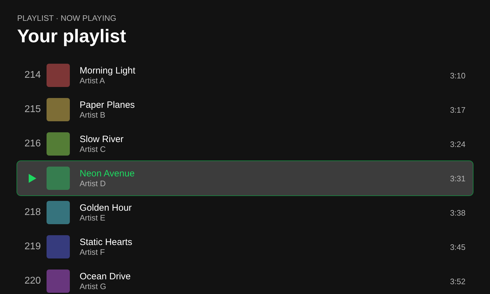

# Jump To Playing

Open the playlist, album or Liked Songs that's currently playing and it scrolls straight to the playing song, centres it and briefly highlights it. No more scrolling through a 2,000-song playlist to find where you are.



## How it works

- Only runs when the page you open is the one that's playing. Other pages are left alone.
- Jumps straight to the song using its position in the list. If the list is sorted differently, it sweeps down until it finds the song.
- Stops as soon as you scroll or press a key, so it never fights you.
- If the same song is in the list twice, it prefers the copy that's actually playing.

## Install

**Marketplace:** search for **Jump To Playing** in the Extensions tab and click Install.

**Manual:**
1. Run `spicetify config-dir` and copy `jumpToPlaying.js` into the `Extensions` folder.
2. Run:
   ```
   spicetify config extensions jumpToPlaying.js
   spicetify apply
   ```

## Compatibility

Tested on Spotify 1.3.6. Spotify updates sometimes rename parts of the app; if it stops working, please open an issue.

## Troubleshooting

Open DevTools (run `spicetify enable-devtools` first, then press Ctrl+Shift+I) and look in the Console for lines starting with `[Jump To Playing]`. Include them in your issue.
